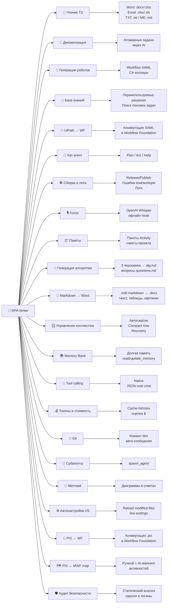

# 🤖 RPA Writer

**RPA Writer** — расширение для Visual Studio, которое превращает разработку RPA-роботов на **Windows Workflow Foundation (WF)** в диалог с AI-агентом.

Агент читает технические задания, декомпозирует их на задачи, генерирует XAML и C#-код роботов, ведёт базу знаний переиспользуемых решений и конвертирует роботов **UiPath и PIX → Workflow Foundation**. Всё это — прямо внутри Visual Studio, в одном окне.

---

## ✨ Что умеет

| Возможность | Описание |
|---|---|
| 📄 Чтение ТЗ | Импорт технических заданий из Word (`.docx`/`.doc`), Excel (`.xlsx`/`.xls`), текста (`.txt`) и markdown (`.md`) |
| 🧩 Декомпозиция | Разбиение ТЗ на атомарные задачи с помощью AI |
| 📐 Генерация алгоритма | Генерация трёх независимых черновиков алгоритма и их консолидация в итоговый `alg.md` и список вопросов `questions.md` |
| 🤖 Генерация роботов | Создание workflow (XAML) и C#-хелперов из спецификации |
| 🧠 База знаний | Накопление переиспользуемых решений и поиск похожих задач |
| 🔁 UiPath → WF | Конвертация роботов UiPath (XAML) в стандартный Workflow Foundation |
| 🔄 PIX → WF | Конвертация роботов PIX (`.pix`) в Workflow Foundation с учётом маппинга активностей |
| 🗺️ PIX ↔ MWF map | Ручной и AI-ассистированный маппинг активностей PIX на активности WF |
| 🛡️ Аудит безопасности | Статический анализ роботов: поиск захардкоженных паролей и логинов |
| 📝 Markdown → Word | Конвертация Markdown (`.md`/`.markdown`) в Word `.docx` (текст, таблицы и картинки) |
| 💬 Чат-агент | Три режима: **Plan** (только чтение/анализ), **Act** (изменения) и **Help** (поддержка по документации) |
| 🔧 Tool calling | Два протокола вызова инструментов: **Native function calling** и **JSON over chat** |
| 🤝 Субагенты | Делегирование задач субагентам (инструмент `spawn_agent`) с отдельным контекстным окном |
| 🎛️ Права агента | По-категорийные права инструментов: чтение, правка файлов, команды, веб, MCP, субагенты |
| 🛠️ Сборка и логи | 1-клик сборка Release/Publish, чтение ошибок компиляции, окна вывода и логов |
| 🪟 Управление контекстом | Автосжатие истории, кнопка «Compact now», индикатор заполнения окна, восстановление при переполнении |
| 📚 Memory Bank | Долговременная память между сессиями (`memory-bank/*.md`, инструменты `read_memory`/`update_memory`) |
| 💰 Токены и стоимость | Учёт cache-hit/miss токенов (DeepSeek/OpenAI) и оценка стоимости в $ по ценам за 1M токенов |
| 🔀 Git | Коммит на ветке `dev`, авто-генерация сообщения, инструменты `git_status`/`git_diff` |
| 📜 Mermaid | Отрисовка Mermaid-диаграмм в ответах агента и сгенерированных алгоритмах |
| ⚙️ Автонастройка VS | Автоматическое включение «Reload modified files» и нормализация переводов строк |
| 🎙️ Голос | Голосовой ввод (OpenAI Whisper или офлайн Vosk) |
| 📦 Пакеты | Управление пакетами Activity/проекта |
| 🔖 Чекпоинты | Авто-снимки файлов перед правками (теневой git-репозиторий) с возможностью сравнения (**Compare**) и отката (**Restore**) |

---

## 🚀 Быстрый старт

1. **Установите** расширение (VSIX) в Visual Studio 2022/2026.
2. Откройте окно **RPA Writer**: `View → Other Windows → RPA Writer` (или через команду меню расширения).
3. Перейдите на вкладку **Settings** и укажите:
   - **Base URL** и **API key** вашего OpenAI-совместимого провайдера (OpenAI, Azure, Ollama, LM Studio, vLLM и др.);
   - **Model** — имя модели;
   - при необходимости — пути к базе знаний и каталогу решений.
4. Нажмите **Save settings**.
5. Вернитесь на вкладку **Chat**, выберите режим и начните диалог.

> 💡 Если ввести только вопрос в свободной форме — агент ответит как чат-ассистент. Подробнее о режимах см. [вкладка Chat](02-chat.md).

---

## 📚 Структура документации

| # | Документ | Содержание |
|---|---|---|
| 1 | [Общее назначение](01-overview.md) | Что такое RPA Writer, установка, терминология, сценарии использования |
| 2 | [Вкладка Chat](02-chat.md) | Чат, режимы Plan/Act/Help, все кнопки, вложения, голос, история, логи, контекст |
| 3 | [Вкладка Spec](03-spec.md) | Импорт ТЗ, поиск похожих, аудит безопасности, доступ к файлам docs |
| 4 | [Вкладка Knowledge base](04-knowledge-base.md) | Формирование базы знаний из роботов |
| 5 | [Вкладка Settings](05-settings.md) | Все настройки с пояснениями и значениями по умолчанию |
| 6 | [Вкладка Packages](06-packages.md) | Управление пакетами |
| 7 | [Вкладка Controls](07-controls.md) | Скрытая вкладка отладки (Notifications / Chat / SVG) |
| 8 | [Режим Help](08-help-mode.md) | Встроенный агент поддержки, отвечающий по документации |
| 9 | [Диагностика и FAQ](09-troubleshooting.md) | Частые проблемы и их решения |
| 10 | [Управление контекстом и память](10-context.md) | Контекстное окно, автосжатие, Memory Bank, токены и стоимость |
| 11 | [Окно Converter](11-converter.md) | Конвертация UiPath/PIX → WF, импорт библиотек активностей, маппинг PIX ↔ MWF |
| 12 | [Чекпоинты](12-checkpoints.md) | Авто-снимки файлов (теневой git-репозиторий), условия отсутствия конфликта с репозиторием робота, Compare/Restore |

---

## 🧭 Навигация по окнам и вкладкам

Главное окно «RPA Writer» содержит вкладки:

- **Chat** — основной чат с агентом;
- **Spec** — работа со спецификацией (ТЗ);
- **Knowledge base** — база знаний решений;
- **Settings** — настройки расширения;
- **Packages** — управление пакетами;
- **Controls** — скрытая вкладка отладки (включается в настройках).

Конвертер вынесен в отдельное окно инструментов: **View → Other Windows → RPA Writer Converter**
(открывается в области документов).

---

## 🆘 Встроенная справка (режим Help)

Во вкладке **Chat** можно переключить режим на **Help**. В этом режиме агент работает как «нежный и внимательный агент поддержки»: ему автоматически подгружается вся эта документация, и он отвечает на вопросы о работе расширения на русском языке.

Подробнее: [Режим Help](08-help-mode.md).
