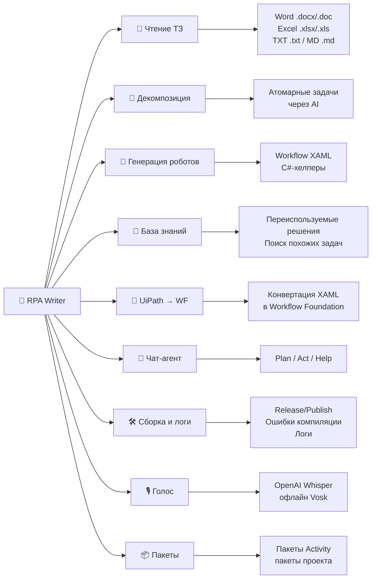

# 🤖 RPA Writer

**RPA Writer** — расширение для Visual Studio, которое превращает разработку RPA-роботов на **Windows Workflow Foundation (WF)** в диалог с AI-агентом.

Агент читает технические задания, декомпозирует их на задачи, генерирует XAML и C#-код роботов, ведёт базу знаний переиспользуемых решений и конвертирует роботов **UiPath → Workflow Foundation**. Всё это — прямо внутри Visual Studio, в одном окне.

---

## ✨ Что умеет

| Возможность | Описание |
|---|---|
| 📄 Чтение ТЗ | Импорт технических заданий из Word (`.docx`/`.doc`), Excel (`.xlsx`/`.xls`), текста (`.txt`) и markdown (`.md`) |
| 🧩 Декомпозиция | Разбиение ТЗ на атомарные задачи с помощью AI |
| 🤖 Генерация роботов | Создание workflow (XAML) и C#-хелперов из спецификации |
| 🧠 База знаний | Накопление переиспользуемых решений и поиск похожих задач |
| 🔁 UiPath → WF | Конвертация роботов UiPath (XAML) в стандартный Workflow Foundation |
| 💬 Чат-агент | Три режима: **Plan** (только чтение/анализ), **Act** (изменения) и **Help** (поддержка по документации) |
| 🛠️ Сборка и логи | 1-клик сборка Release/Publish, чтение ошибок компиляции, окна вывода и логов |
| 🎙️ Голос | Голосовой ввод (OpenAI Whisper или офлайн Vosk) |
| 📦 Пакеты | Управление пакетами Activity/проекта |

---

## 🚀 Быстрый старт

1. **Установите** расширение (VSIX) в Visual Studio 2022/2026.
2. Откройте окно **RPA Writer**: `View → Other Windows → RPA Writer` (или через команду меню расширения).
3. Перейдите на вкладку **Settings** и укажите:
   - **Base URL** и **API key** вашего OpenAI-совместимого провайдера (OpenAI, Azure, Ollama, LM Studio, vLLM и др.);
   - **Model** — имя модели;
   - при необходимости — пути к базе знаний и каталогу решений.
4. Нажмите **Save settings**.
5. Вернитесь на вкладку **Chat**, выберите режим и начните диалог.

> 💡 Если ввести только вопрос в свободной форме — агент ответит как чат-ассистент. Подробнее о режимах см. [вкладка Chat](02-chat.md).

---

## 📚 Структура документации

| # | Документ | Содержание |
|---|---|---|
| 1 | [Общее назначение](01-overview.md) | Что такое RPA Writer, установка, терминология, сценарии использования |
| 2 | [Вкладка Chat](02-chat.md) | Чат, режимы Plan/Act/Help, все кнопки, вложения, голос, история, логи, контекст |
| 3 | [Вкладка Spec](03-spec.md) | Импорт ТЗ, поиск похожих, конвертация UiPath → WF |
| 4 | [Вкладка Knowledge base](04-knowledge-base.md) | Формирование базы знаний из роботов |
| 5 | [Вкладка Settings](05-settings.md) | Все настройки с пояснениями и значениями по умолчанию |
| 6 | [Вкладка Packages](06-packages.md) | Управление пакетами |
| 7 | [Вкладка Controls](07-controls.md) | Скрытая вкладка отладки (Notifications / Chat / SVG) |
| 8 | [Режим Help](08-help-mode.md) | Встроенный агент поддержки, отвечающий по документации |
| 9 | [Диагностика и FAQ](09-troubleshooting.md) | Частые проблемы и их решения |

---

## 🧭 Навигация по вкладкам окна

Главное окно содержит вкладки:

- **Chat** — основной чат с агентом;
- **Spec** — работа со спецификацией (ТЗ);
- **Knowledge base** — база знаний решений;
- **Settings** — настройки расширения;
- **Packages** — управление пакетами;
- **Controls** — скрытая вкладка отладки (включается в настройках).

---

## 🆘 Встроенная справка (режим Help)

Во вкладке **Chat** можно переключить режим на **Help**. В этом режиме агент работает как «нежный и внимательный агент поддержки»: ему автоматически подгружается вся эта документация, и он отвечает на вопросы о работе расширения на русском языке.

Подробнее: [Режим Help](08-help-mode.md).
