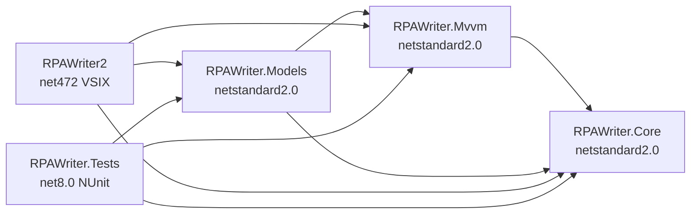

# 13. Слой моделей (Model layer)

Модели RPA Writer живут в двух отдельных сборках, которые **не знают о WPF и Visual Studio**:

| Сборка | TFM | Что внутри | Чего быть не может |
|---|---|---|---|
| `RPAWriter.Core` | `netstandard2.0` | домен, сервисы, контракты (`ChatMessage`, `ChatPayload`-типы, `ChatConversation`, `PendingMessage`, `UiStateData`, `LogParser`, `PromptLibrary`, `IChatHistoryStore`, `IUiStateStore`, …) | WPF, DTE, SQLite, `Dispatcher` |
| `RPAWriter.Mvvm` | `netstandard2.0` | каркас MVVM: `BaseEntity`, `BaseModel`, `BaseViewModel`, `IView`, `RelayCommand`, `Notify`, `NotifyLevel`, `ViewMode` | WPF (`System.Windows`), `CommandManager` |
| `RPAWriter.Models` | `netstandard2.0` | модели продукта: `ChatModel`, `LogAnalyzer`, … | WPF, `Material.Icons`, SQLite, `EnvDTE`, ссылка на `RPAWriter2` |
| `RPAWriter2` | `net472` (VSIX) | View (XAML + code-behind), ViewModel-адаптеры, `MvvmFactory`, VS-сервисы, SQLite | бизнес-логика моделей |
| `RPAWriter.Tests` | `net8.0` (NUnit) | тесты Core, `RPAWriter.Mvvm` и `RPAWriter.Models` | ссылка на `RPAWriter2` |



---

## 1. Правило первое: модель стартует без ViewModel и без View

Модель — это обычный класс. Её можно создать, вызвать у неё методы и проверить состояние,
**не создавая ни ViewModel, ни View, ни `Application`, ни Visual Studio**:

```csharp
var model = new ChatModel(new InMemoryChatHistoryStore(), new InMemoryUiStateStore());
model.Run();               // никакого UI не требуется
model.NewChatCommand();
Assert.That(model.History, Is.Empty);
```

Отсюда следует, что конструктор модели:

- не обращается к `ViewModel`, `IView`, `Application.Current`, `Dispatcher`, `Window`, `Clipboard`, `MessageBox`;
- не берёт VS-сервисы из статического контейнера — всё внешнее приходит параметрами конструктора в виде интерфейсов;
- не читает файловую систему напрямую, если это можно спрятать за контрактом (`IChatHistoryStore`, `IUiStateStore`, `ILogProviderLoader`).

Каждая модель обязана иметь тест вида `…_CanBeConstructedWithoutViewModelAndView`
(эталон: `ModelLayerTests.Model_CanBeConstructedWithoutViewModelAndView`).

## 2. Правило второе: модель полностью покрыта тестами

- Модель без тестов не считается готовой. Покрытие `RPAWriter.Models` — не ниже **90 % строк** (coverlet).
- Всё, что не удаётся протестировать на `net8.0`, — это не «сложное место», а признак того,
  что логика положена не туда: такая логика выносится в `RPAWriter.Core` (сервис), а модель её вызывает.
- В модели нет `#if DEBUG`, статических изменяемых полей и скрытых зависимостей от времени:
  текущее время и `Guid` приходят через внедряемый `Func<DateTime>`/`Func<string>` (или фабрику идентификаторов),
  если от них зависит результат.
- Внешние зависимости в тестах заменяются **ручными фейками** (`InMemoryChatHistoryStore`, `FakeAiProvider`,
  `StubProdLogProvider`) — так уже написано большинство тестов в `RPAWriter.Tests`.

## 3. Правило третье: состояние — это `public`-свойство с уведомлением

```csharp
private ObservableCollection<ChatConversation> _history = new ObservableCollection<ChatConversation>();

public ObservableCollection<ChatConversation> History
{
    get => _history;
    private set => SetProperty(ref _history, value);
}
```

- Свойства модели — `public`. `private`-свойство нельзя ни связать с XAML, ни проверить в тесте
  (антипример: прежний `RPAWriter2/Models/ChatModel.cs`, где все свойства были `private`).
- Коллекции — `ObservableCollection<T>`, инициализируются **в объявлении или в конструкторе**:
  у модели не бывает `null`-коллекций.
- Никаких `null`-значений «по умолчанию» у вложенных моделей: дочерняя модель либо создана в конструкторе,
  либо её `null` явно документирован и обрабатывается.

## 4. Правило четвёртое: команда — это `public`-метод без перегрузок

XAML вызывает команды через `Cmd` + `CommandParameter`:

```xml
<Button Content="New chat" Command="{Binding Cmd}" CommandParameter="NewChatCommand" />
```

`BaseModel.SendCommand` находит метод по имени через `GetType().GetMethod(name)`, поэтому:

- метод должен быть `public`;
- перегрузки запрещены (найдётся первая попавшаяся или ничего);
- метод не должен бросать исключения в UI-поток без обработки — ошибки сообщаются через `NotifyMessage`.

В тестах команда вызывается **прямым вызовом метода**, без `Cmd` и без XAML.

## 5. Правило пятое: никакого UI в модели

| Модель хочет | Разрешено | Запрещено |
|---|---|---|
| Показать информацию | `NotifyMessage(new Notify { Message = "…", NotifyLevel = NotifyLevel.Success })` | `MessageBox.Show`, `NotificationBanner` |
| Спросить подтверждение | `ShowDialogMessage("…")` | `new Window().ShowDialog()` |
| Обновить состояние UI | изменить своё свойство | `Dispatcher.Invoke`, `button.IsEnabled = false` |

События `ShowDialog` и `Notify` подписываются во View через `MvvmFactory` — модель о подписчике не знает.

## 6. Правило шестое: без `Dispatcher`, асинхронность до конца

- Модель не маршалит потоки: `async`/`await` в модели, возврат в UI-поток — задача View/ViewModel.
- `Task` в модели означает «работу с внешним миром» (сеть, диск, VS). Такая зависимость внедряется
  интерфейсом и в тестах заменяется фейком, а не реальной сетью.
- Долгие операции выставляют `IsBusy` и снимают его в `finally` — и при исключении тоже.

## 7. Правило седьмое: дочерние модели подключаются лениво

```csharp
MvvmFactory.Attach(chatModel, chatViewModel, this, this);   // Attach никогда не требует View
MvvmFactory.RegisterModel(chatModel, chatModel.LogAnalyzer); // после Attach, в любом порядке
```

- `RegisterModel(parent, child)` **не** требует, чтобы у родителя уже была ViewModel
  (отличие от исходного `EasyMvvm`, где стоял `throw new Exception("parentModel.ViewModel is null")`).
- Сообщения дочерней модели транслируются в родительскую (`child.ShowDialog → parent.ShowDialogMessage`),
  поэтому View нужен только корневой модели.
- Порядок для View-хоста: `Attach`/`CreateWindow` → затем `RegisterModel` для детей.

## 8. Правило восьмое: персистентность — за интерфейсами

Модель не знает про SQLite, `%AppData%` и JSON-файлы:

```csharp
public interface IChatHistoryStore
{
    void Initialize();
    IReadOnlyList<ChatConversation> ListConversations(int limit = 50);
    ChatConversation LoadConversation(string id);
    void SaveConversation(ChatConversation conversation);
    void DeleteConversation(string id);
    void DeleteAllConversations();
}
```

Реализация с SQLite (`ChatHistoryStore`) и с JSON (`UiStateStore`) живёт в `RPAWriter2/Services`,
а в тестах подставляется `InMemoryChatHistoryStore`. Интерфейсы объявлены в `RPAWriter.Core/Contracts/StorageContracts.cs` (вместе с `IUiStateStore` для `UiStateData`).

## 9. Правило девятое: границу сборки обеспечивает TFM и тест-страж

`ModelArchitectureTests` падает, если:

- `RPAWriter.Models` или `RPAWriter.Mvvm` перестанут быть `netstandard2.0`;
- в их ссылках появится `PresentationFramework`, `PresentationCore`, `WindowsBase`, `System.Xaml`,
  `System.Windows.Forms`, `Material.Icons`, `System.Data.SQLite`, `EnvDTE*`, `Microsoft.VisualStudio.Shell*`;
- `RPAWriter.Models` начнёт ссылаться на `RPAWriter2`;
- в `RPAWriter.Models` появится публичный тип в пространстве имён `System.Windows.*`.

То есть «положил WPF-тип в модель» — это не замечание на ревью, а красная сборка.

## 10. Правило десятое: layout state остаётся во View

В модели **не** живут: `Visibility`, `IsPanelVisible`, фокус, размеры, `SelectedIndex` ради скролла,
ссылки на контролы. Видимость панелей вкладки Chat переключают обработчики XAML
(`OnAnalyzeLogs`, `OnAnalyzeLogsFromProdServers`, `OnCloseAnalyzeLogs`), а не модель.

Если условие «можно выполнять действие» зависит от того, что видно на экране, — в модели должно быть
**бизнес-условие**, а не проверка `Visibility`:

```csharp
// было (в code-behind): if (ProdLogsPanel.Visibility != Visibility.Visible) return;
// стало (в модели):
if (SelectedProvider == null || string.IsNullOrWhiteSpace(RobotName)) return;
```

Исключение — навигационное состояние, которое персистится и влияет на команды: `ChatViewMode`
(Conversation / History) допустимо держать в модели, потому что оно сохраняется в `ui_state.json`.

Следствие для биндингов: обработчик, который **действует** (загружает, обновляет), не полагается на
двустороннюю привязку — WPF поднимает `SelectionChanged`/`SelectedDateChanged` раньше, чем привязка
обновит источник, поэтому значение передаётся модели явно (см. 19.2).

---

## 11. Жизненный цикл модели

| Метод | Когда вызывается | Что можно делать |
|---|---|---|
| `Run()` | до привязки к View; вызывается из `MvvmFactory.Attach`/`CreateWindow` | инициализация, чтение настроек, подписки — без UI |
| `AfterLoaded()` | сразу после установки `DataContext` и подписки на события View | наполнение коллекций, первичная загрузка (bindings уже живы) |
| `Loaded()` | по событию `FrameworkElement.Loaded` | действия, которым нужен реально показанный контрол (фокус — через View) |
| `Closing()` | по событию `FrameworkElement.Unloaded` (или `Window.Closing`) | **синхронный** сброс состояния на диск |

`Run`, `AfterLoaded`, `Loaded`, `Closing` в `BaseModel` — `virtual` с пустой реализацией:
модель без UI не обязана их переопределять.

## 12. Отличия от `MyBot/EasyMvvm/Core` и примеров в `Stealth`

| Аспект | `MyBot/EasyMvvm/Core` | `RPAWriter.Mvvm` (наш форк) |
|---|---|---|
| Зависимость от WPF | `BaseModel.Close()` кастует `View` в `Window`; `MvvmFactory.CreateWindow` работает только с `MetroWindow` | нет `System.Windows` вообще; `Close()` отсутствует (закрытие — дело View) |
| События | `SendMessage` + `OnSendMessage` (async в `IView`) | `ShowDialog` (модальное сообщение) + `Notify` (уведомление) |
| Методы поднятия событий | `protected virtual` → наружу не видны | `public ShowDialogMessage`/`NotifyMessage` → дочерняя модель может транслировать событие в родителя без ViewModel |
| Жизненный цикл | `Run`, `Loaded`, `AfterLoaded`, `AfterLoadedAsync`, `Closing` | `Run`, `AfterLoaded`, `Loaded`, `Closing` (без async-версии: async — это `Task`-метод модели) |
| `Attach` для контролов | нет, только окна | `MvvmFactory.Attach(model, vm, FrameworkElement, host)` — для вкладок и `UserControl` |
| `RegisterModel` без ViewModel | `throw` | допускается |
| `RelayCommand` | `CommandManager.RequerySuggested` | собственный `CanExecuteChanged` + `RaiseCanExecuteChanged()` |
| Обязательность ViewModel | есть (`SetModel` до всего) | опциональна: `Attach` умеет `DataContext = model` |
| Раскладка по проектам | папка `Core` внутри одного решения | отдельные сборки `RPAWriter.Mvvm` + `RPAWriter.Models` |

Из `Stealth` (`C:\Users\Maxxx\source\repos\MyBot\Stealth`) берём структуру `Models/`, `ViewModels/`, `Views/`
и правило «модель ничего не знает про View». **Но не берём** локатор сервисов (`Services`) —
в нашем форке зависимости приходят только через конструктор, иначе модель нельзя собрать в тесте руками.

## 13. Стек тестирования

| Задача | Выбор | Почему |
|---|---|---|
| Раннер и атрибуты | **NUnit 3.14** + `NUnit3TestAdapter` + `Microsoft.NET.Test.Sdk` | уже используется в 60+ фикстурах `RPAWriter.Tests` |
| Проверки | **NUnit constraint model**: `Assert.That(actual, Is.EqualTo(expected))` | без внешних зависимостей; `FluentAssertions 8` — платная лицензия Xceed |
| Фейки | **ручные классы-фейки** в тестовом проекте (`InMemory…`, `Fake…`, `Recording…`, `Stub…`) | консистентно с существующими тестами, ноль зависимостей |
| Моки | **NSubstitute 5.x — только по необходимости** | `Moq 4.20+` тянет SponsorLink-телеметрию — не используем |
| Покрытие | **coverlet** (уже подключён) + `--collect:"XPlat Code Coverage"` | порог 90 % строк для `RPAWriter.Models` |
| WPF/STA | **не требуются** | модели и каркас — `netstandard2.0` без UI-типов |

Запуск:

```powershell
dotnet test RPAWriter.Tests\RPAWriter.Tests.csproj
dotnet test RPAWriter.Tests\RPAWriter.Tests.csproj --filter "FullyQualifiedName~ModelLayerTests"
dotnet test RPAWriter.Tests\RPAWriter.Tests.csproj --collect:"XPlat Code Coverage"
```

Тестовый проект **не** ссылается на VSIX: если модели понадобился тип из `RPAWriter2`,
это ошибка слоя, а не повод добавить `net472`-тесты.

## 14. Чек-лист: добавляю новую модель

1. Класс в `RPAWriter.Models`, наследуется от `RPAWriter.Mvvm.BaseModel`; ничего из `System.Windows` не импортируется.
2. Все внешние зависимости — интерфейсы в конструкторе (`RPAWriter.Models/Interfaces`), реализация — в `RPAWriter2`.
3. Все свойства `public`, коллекции инициализированы, дочерние модели создаются в конструкторе или `null` документирован.
4. Методы-команды `public`, без перегрузок; ошибки — через `NotifyMessage`, вопросы — через `ShowDialogMessage`.
5. Чистая логика, которую нужно покрыть отдельно, вынесена в `RPAWriter.Core` (сервис) и протестирована там.
6. Написаны тесты: конструктор без VM/View, успешный сценарий, ошибки, граничные случаи (`RPAWriter.Tests`).
7. ViewModel (если нужна) — тонкий адаптер в `RPAWriter2`; в ней нет бизнес-логики.
8. Подключение: `MvvmFactory.Attach(...)` при создании контрола, затем `RegisterModel(...)` для детей.
9. `dotnet test` зелёный, `ModelArchitectureTests` зелёный, покрытие модели ≥ 90 %.

## 15. Антипримеры из прежнего кода

| Антипример | Где было | Чем плохо |
|---|---|---|
| `private ChatConversation ActiveChatConversation { get; set; }` | `RPAWriter2/Models/ChatModel.cs` | нельзя связать с XAML, нельзя проверить тестом |
| `ObservableCollection<ChatConversation> History { get; set; }` без инициализации | там же | `NullReferenceException` при первом `Add` |
| `LogAnalyzer LogAnalyzer { get; set; }` без создания | там же | дочерняя модель всегда `null` |
| 4800+ строк бизнес-логики в `ToolWindow1Control.xaml.cs` | code-behind вкладки Chat | логика недостижима из тестов, любое изменение — риск для UI |
| `_logProviders = null` как способ «сбросить кэш» из настроек | `OnSaveSettings` | модель должна иметь явный `InvalidateProviders()` |
| Проверка `ProdLogsPanel.Visibility != Visibility.Visible` как условие загрузки данных | code-behind | бизнес-условие подменено состоянием оформления |

---

## 16. Где живёт домен чата (после фазы B)

Типы, которые раньше лежали в корне VSIX-проекта (`RPAWriter2/*.cs`, namespace `RPAWriter2`),
перенесены в `RPAWriter.Core/Models` и доступны моделям без WPF:

| Файл | Типы |
|---|---|
| `Core/Models/ChatMessage.cs` | `ChatMessage` (Kind, Payload, Reason, Mode, `Blocks`, `DisplayText` …) |
| `Core/Models/ChatPayloads.cs` | `ChatPayload`, `TextPayload`, `ToolCallPayload`, `QuestionPayload`, `SubagentStatusItem`, `SubagentPayload`, `CheckpointPayload` |
| `Core/Models/ChatAttachment.cs` | `ChatAttachment` (+ `ToImagePart()` → `ChatImagePart`) |
| `Core/Models/ChatHistory.cs` | `ChatHistoryMessage`, `ChatConversation` (INPC + `IsActive`) |
| `Core/Models/PendingMessage.cs` | `PendingDelivery`, `PendingMessage` (очередь сообщений) |
| `Core/Models/UiState.cs` | `ChatViewMode`, `MainTab`, `UiStateData` |
| `Core/Contracts/StorageContracts.cs` | `IChatHistoryStore`, `IUiStateStore` |

Что при этом изменилось по правилам:

- `ChatConversation` реализует `INotifyPropertyChanged` и получила `IsActive` — на нём держится зелёный
  индикатор активной беседы в списке истории. Флаг **не** сериализуется в SQLite.
- `PendingChatMessage` → `PendingMessage`; `DeliveryIcon` (`MaterialIconKind`) удалён из модели,
  иконку выдаёт `RPAWriter2/Converters/PendingDeliveryToGeometryConverter` по значению `Delivery`.
- `ChatHistoryStore` и `UiStateStore` остались статическими «сырыми» хранилищами в `RPAWriter2/Services`;
  модели работают через `IChatHistoryStore`/`IUiStateStore`, которые адаптируют
  `SqliteChatHistoryStore` и `JsonUiStateStore`.
- `ModelArchitectureTests.ChatDomainTypes_LiveInCore` и `PendingMessage_ExposesNoIconProperty`
  не дают вернуть эти типы обратно в VSIX-проект или протащить в них иконки.

Порядок переноса при добавлении нового доменного типа: сначала тест на поведение в `RPAWriter.Tests`,
затем тип в `Core/Models`, затем `using RPAWriter.Core.Models;` во View — и только после этого правки XAML.

---

## 17. `ChatModel` — эталон модели продукта (после фазы C)

`RPAWriter.Models/ChatModel.cs` — первая модель, полностью живущая по правилам этого документа:
создаётся без ViewModel и View, состояние и сценарии покрыты 63 тестами `ChatModelTests`.

### 17.1. Что модель владеет

| Состояние | Член | Примечание |
|---|---|---|
| Транскрипт | `Messages` | та же коллекция, что показывает `ChatMessagesControl` |
| Очередь сообщений | `Pending` | `Enqueue`/`DequeueNext`, приоритет `PendingDelivery.Steer` |
| Вложения | `Attachments` | очищаются хостом после отправки |
| История | `History` | заполняется из `IChatHistoryStore.ListConversations()` |
| Активная беседа | `ActiveChatConversation`, `ActiveConversationId` | сеттер двигает `IsActive` по всей истории |
| Режим вкладки | `ViewMode` (`ChatViewMode`) | персистится в `ui_state.json` |
| Pinned | `PinnedMessage`, `HasPinnedMessage` | первое сообщение пользователя, иначе первое сообщение |
| Состояние агента | `Mode`, `Phase` (`AgentMode`, `AgentPhase`) | читается футером через хост |
| Флаг изменений | `IsDirty` | `true` после любого добавления в transcript |
| Ошибка операции | `LastError` | модель не бросает и не показывает диалоги сама |

Сценарии: `Run()`, `Closing()`, `StartNewChat()`, `OpenConversation(id)`, `DeleteConversation(id)`,
`ClearHistory()`, `ResetConversation()`, `SaveHistoryNow()`, `RefreshHistory()`, `RefreshPinnedMessage()`,
`Enqueue()`, `DequeueNext()`, `ShowConversationView()`, `ShowHistoryView()`,
`LoadUiState()`, `PersistUiState(activeTab)`, `ResolveConversationToOpen(id)`.
Команды для `Cmd`: `NewChatCommand`, `OpenConversationCommand(object)`, `DeleteConversationCommand(object)`,
`ClearHistoryCommand`, `RefreshHistoryCommand` — все `public`, без перегрузок (требование `BaseModel.SendCommand`).

### 17.2. Как модель реагирует на изменения коллекции

Модель подписана на `Messages.CollectionChanged`, поэтому неважно, кто добавил сообщение — сама модель
(`AppendMessage`) или контрол (`ChatMessagesControl.Append` делит с моделью одну коллекцию). Реакция:

- пришло сообщение пользователя, а pinned пуст → `RefreshPinnedMessage()`;
- любое добавление → `IsDirty = true` (кроме загрузки сохранённой беседы, она идёт с `_suppressDirty`);
- `Clear()` → pinned сбрасывается, `IsDirty` не меняется (сброс сам помечает состояние по `markDirty`).

Дебаунс записи остался в хосте: `DispatcherTimer` в контроле вызывает `SaveHistoryNow()` только когда
`IsDirty` (таймер — это UI-инфраструктура, а не бизнес-логика). `Closing()` модели — последний
синхронный сброс перед выгрузкой вкладки.

### 17.3. Что осталось в хосте (и почему)

| Обязанность хоста | Почему не модель |
|---|---|
| Запуск агента, `CancellationTokenSource`, resume-снимок | зависит от VS/провайдера, асинхронный UI-сценарий |
| Чекпоинты (`RehydrateCheckpoints`, baseline, `_iterationNumber`) | теневой git-репозиторий и DTE |
| `ChatMessages.ScrollToEnd()`, `ApplyChatViewMode()`, `_pinnedExpanded` | layout state (правило 10) |
| `MessageDialog.Show(...)` при удалении/очистке | модальный диалог — View; модель лишь сообщает результат и `LastError` |
| Публикация `PersistUiState` по событиям вкладок | активная вкладка — состояние View, передаётся в модель параметром |

### 17.4. Приём «алиасы» при инкрементальном переносе

Чтобы перенести 4800 строк code-behind без «красной» сборки, поля контрола заменены свойствами,
которые делегируют модели, и остальной код не менялся:

```csharp
private ObservableCollection<ChatMessage> _messages => _chatModel.Messages;
private ChatConversation _currentConversation
{
    get => _chatModel.ActiveChatConversation;
    set => _chatModel.ActiveChatConversation = value;
}
private ChatViewMode _chatViewMode { get => _chatModel.ViewMode; set => _chatModel.ViewMode = value; }
```

Это временный мост: на фазе E обработчики и XAML переходят на биндинги, алиасы удаляются.
Правило: алиас только читает/пишет модель, никакой логики в нём нет.

### 17.5. Зелёный индикатор активной беседы

`ChatConversation.IsActive` выставляется моделью (`ActiveChatConversation` → `UpdateActiveFlags()`),
в SQLite не пишется. В `ToolWindow1Control.xaml` (карточка истории) добавлен `Ellipse` с
`Visibility="{Binding IsActive, Converter={StaticResource BoolToVis}}"`. Проверки в тестах:
`OnlyTheActiveConversationIsMarkedActive`, `RefreshHistory_ClearsStaleIndicators`,
`StartNewChat_ClearsActiveIndicators`.

### 17.6. Тестовое покрытие модели

| Фикстура | Что покрывает | Тестов |
|---|---|---|
| `ChatModelTests` | конструктор без VM/View, `Run`/`Closing`, pinned, save/title/`IsDirty`, New/Open/Delete/Clear, `IsActive`, очередь, view mode и UI-state, команды через рефлексию | 63 |
| `ChatMessageMapperTests` | маппинг `ChatMessage ↔ ChatHistoryMessage` (checkpoint, question, tool call/blocked, текст), `BuildTitle` | 14 |
| `ModelArchitectureTests` | TFM и UI-free границы + `ChatModel_ExposesNoLayoutState` | 14 |

Фейки сценария живут в `RPAWriter.Tests/Fakes`: `InMemoryChatHistoryStore` (глубокие копии при
save/load, «новые сверху», падение по требованию) и `InMemoryUiStateStore`.

---

⬅️ Назад: [Чекпоинты](12-checkpoints.md) · [К началу документации](00-index.md)

## 18. `LogAnalyzer` — модель панели Analyze logs (после фазы D)

Вторая эталонная модель после `ChatModel`. Отвечает на вопрос «что происходит, когда пользователь нажимает Analyze logs»: получает данные (провайдеры, задачи, логи), парсит их и отправляет готовый промт в чат.

### 18.1. Состояние модели

| Член | Назначение |
|---|---|
| `Providers`, `SelectedProvider` | Провайдеры, найденные в каталоге (`LogProviderLoader`), и выбранный |
| `Tasks`, `SelectedTask` | Задачи робота и выбранная задача |
| `Logs` | Строки лога выбранной задачи — **единственный** источник для анализа |
| `LogsLoaded` | `true` после завершения запроса логов (отличает «ещё не грузили» от «загрузка пустая») |
| `RobotName`, `CurrentRobotName`, `RobotNameSuggestions` | Фильтр по роботу и история имён |
| `MinLevelOptions`, `SelectedMinLevel` | Фильтр по уровню (`LogLevelOption`: заголовок + `LogLevel?`) |
| `FromDate`, `ToDate` | Границы диапазона запусков |
| `StatusText`, `IsBusy`, `LastError` | Прогресс, результат, последняя ошибка (тексты — данные, а не разметка) |

Коллекции — `ObservableCollection`, создаются в конструкторе; `MinLevelOptions` = «All» + все значения `LogLevel`.

### 18.2. Сценарии

| Метод | Поведение (перенесено из `ToolWindow1Control`) |
|---|---|
| `Prepare()` | `EnsureProviders()` + сообщение «провайдер не найден», если список пуст |
| `LoadTasksAsync()` | нормализация имени робота, запись в историю, `GetTasksAsync`, статусы «Loading tasks…» / «N task(s) loaded», очистка `Logs` и `SelectedTask` |
| `RefreshLogsAsync()` | без задачи — молча очищает логи; иначе `GetLogsAsync`, статус «N log entry/entries loaded» |
| `AnalyzeFromOutputWindowAsync()` | читает Output window, пустой → `NoticeAsync`, иначе промт в чат; `true` = отправлено |
| `AnalyzeFromProdLogsAsync()` | `LogsLoaded == false` → «Load logs first.», пусто → «No log entries to analyze.», иначе `Map` → `Analyze` → `BuildPrompt` → чат |

Все ошибки провайдера/сети дают `StatusText` («Failed to load …: …»), `LastError` и карточку ошибки через `IUserMessageSink`; `IsBusy` снимается в `finally`.

### 18.3. Что осталось во View

- `AnalyzeLogsPanel.Visibility`, `ProdLogsPanel.Visibility` — layout state (правило 10);
- гвард «панель видима и имя робота введено» в обработчике смены дат;
- мост «экран → модель» `PushPanelInputsToModel` (см. 19.2): биндинги показывают состояние модели, а обработчик, который сразу действует, передаёт значения явно;
- `OnRobotNameKeyDown` — Enter в поле робота запускает сценарий модели; `OnProviderChanged` удалён (провайдер выбирается биндингом).

Бизнес-гвард при этом переехал в модель: вместо `ProdLogsPanel.Visibility` проверяется `CanLoadTasks` (есть имя робота и провайдер).

### 18.4. Контракты хоста (`RPAWriter.Core/Contracts/LogAnalysisContracts.cs`)

| Контракт | Зачем |
|---|---|
| `ILogProviderSource` | `ResolveDirectory()`, `Discover(dir)`, `CreateFallback()` — обёртка над `LogProviderLoader`/`StubProdLogProvider` |
| `IOutputWindowTextSource` | `GetTextAsync()` — обёртка над `IBuildFeedbackService` |
| `IChatPromptSink` | `SendPromptAsync(prompt)` — отправка промта в чат |
| `IUserMessageSink` | `NoticeAsync` / `ErrorAsync` — карточки-уведомления и ошибки |
| `ILogAnalysisSettings` | путь к провайдерам + история имён роботов (чтение/запись) |

Реализации — `RPAWriter2/Services/LogAnalysisAdapters.cs` (единственное место, знающее про диск, Output window и `SettingsStore`).

### 18.5. Core-сервисы (тестируются отдельно)

| Тип | Ответственность |
|---|---|
| `ProdLogAnalysisService` | `Map(IProdLog)`, `MapAll`, `Analyze`, `BuildPrompt`/`BuildOutputWindowPrompt`, `FormatTimestamp`, `FormatParameters`; лимиты 40000 символов, 50 строк ошибок/предупреждений, 200 строк лога. Заголовки промтов инжектируются в конструктор — тесты не читают файловую систему |
| `ProdLogQueryBuilder` | `Build(minLevel, fromDate, toDate)`: `FromUtc` = начало дня (UTC), `ToUtc` = последний тик дня (UTC) |
| `RobotNameHistory` | `Add`/`Normalize`/`ResolveCurrent`/`ResolveSuggestions`: свежие сверху, без дублей (регистронезависимо), лимит 20, плейсхолдер `RPA-` не запоминается |
| `LogLevelOption` | Элемент фильтра уровня (данные, не UI-тип) |

### 18.6. Порядок подключения в хосте

1. Создать адаптеры (они читают поля контрола лениво, поэтому порядок `LoadSettings` не важен).
2. `_chatModel.LogAnalyzer = CreateLogAnalyzer();`
3. `MvvmFactory.Attach(_chatModel, _chatViewModel, this)` — `ChatModel.Run()` вызывает `LogAnalyzer.Run()`, который читает историю имён роботов.
4. Ничего больше: `ProdLogsPanel` получает `DataContext="{Binding Chat.LogAnalyzer}"` и показывает состояние модели сам (§19).
5. `PushPanelInputsToModel` вызывают только обработчики, которые сразу действуют (см. 19.2).
5. ~~`SyncLogAnalyzerPanel()` + `SyncRobotNameBox()`~~ — удалены в фазе E: статус, выбранный провайдер и имя робота показывают биндинги.

`InvalidateProviders()` вызывается из `OnSaveSettings` вместо прежних `_logProviders = null` — иначе после смены каталога модель держала бы устаревший список. Метод сбрасывает только результаты discovery (провайдеры и выбор), а загруженные задачи и логи оставляет: сохранение настроек не должно стирать то, что пользователь уже загрузил.

### 18.7. Покрытие

`ProdLogAnalysisServiceTests`, `ProdLogQueryBuilderTests`, `RobotNameHistoryTests`, `LogAnalyzerTests` (на конец фазы D — 87 тестов): конструктор без VM/View, нормализация истории, идемпотентность `Prepare`/`InvalidateProviders`, все ветки `LoadTasks`/`RefreshLogs` (успех, пустой результат, исключение провайдера), оба сценария анализа (промт отправлен ровно один раз), команды `*Command` через `SendCommand`, отсутствие UI-зависимостей.

### 18.8. Что сознательно не перенесено

- Инструмент агента `analyze_logs` (`AgentToolFactory`) сохраняет свой компактный формат вывода: это текст для модели, а не промт панели; `LogParser` он уже использует из Core.
- Таймеры, `Dispatcher`, `MessageBox`, модальные подтверждения — по правилам 5, 6 и 10.

---

## 19. Панель Analyze logs на биндингах (фаза E)

### 19.1. Что связано и чем

`ProdLogsPanel` получает `DataContext="{Binding Chat.LogAnalyzer}"`, поэтому контролы панели видят
дочернюю модель напрямую и не требуют ни `ItemsSource`-присваиваний, ни синхронизации.

| Контрол | Привязка |
|---|---|
| `MinLevelCombo` | `ItemsSource={Binding MinLevelOptions}`, `DisplayMemberPath=Title`, `SelectedItem={Binding SelectedMinLevel}` |
| `FromDatePicker`, `ToDatePicker` | `SelectedDate={Binding FromDate}` / `{Binding ToDate}` |
| `RobotNameBox` | `ItemsSource={Binding RobotNameSuggestions}`, `Text={Binding RobotName, UpdateSourceTrigger=PropertyChanged}` |
| `ProviderCombo` | `ItemsSource={Binding Providers}`, `DisplayMemberPath=Name`, `SelectedItem={Binding SelectedProvider}`, `Visibility={Binding Providers.Count, Converter={StaticResource MultiProviderVisibility}}` |
| `TasksGrid` | `ItemsSource={Binding Tasks}`, `SelectedItem={Binding SelectedTask}` |
| `LogsGrid` | `ItemsSource={Binding Logs}` |
| `ProdLogsStatusText` | `Text={Binding StatusText}` |

`Visibility` комбобокса провайдеров считается конвертером (`CountToVisibilityConverter`, порог 1):
решение «показывать, только если есть выбор» — разметка, а не модель (правило 10). Сам факт
«провайдеров несколько» модель не описывает.

`ChatModel.LogAnalyzer` — обычное свойство с `SetProperty`: панель биндится на него, поэтому
переустановка модели обновляет `DataContext`. Если модель назначают после `ChatModel.Run()`,
она запускается сразу (иначе не загрузилась бы история имён роботов).

### 19.2. Ловушка WPF: событие приходит раньше биндинга

`Selector.SelectionChanged` и `DatePicker.SelectedDateChanged` поднимаются из
`PropertyChangedCallback` (то есть внутри `SetValue`), а двусторонняя привязка обновляет источник
позже — в `DependencyObject.OnPropertyChanged`. Обработчик, который сразу вызывает модель, увидел бы
**старое** значение (классический симптом: «выбрал задачу, а логи загрузились предыдущей»).

Поэтому в хосте остаётся один явный мост:

```csharp
// ToolWindow1Control.xaml.cs
private void PushPanelInputsToModel(LogAnalyzer analyzer)
{
    analyzer.RobotName = (RobotNameBox?.Text ?? "").Trim();
    if (MinLevelCombo?.SelectedItem is LogLevelOption option)
        analyzer.SelectedMinLevel = option;
    analyzer.FromDate = FromDatePicker?.SelectedDate;
    analyzer.ToDate = ToDatePicker?.SelectedDate;
    analyzer.SelectedTask = TasksGrid?.SelectedItem as ProdTask;
}
```

Это не дублирование биндинга: привязка отвечает за направление «модель → экран» и за обычный ввод,
а мост — за «экран → модель» **в момент действия**. Правило: обработчик, который действует
(загружает, анализирует), не полагается на двустороннюю привязку и передаёт значение явно.

### 19.3. Что осталось во View после фазы E

- `AnalyzeLogsPanel.Visibility`, `ProdLogsPanel.Visibility`, гвард «панель видима» в обработчике дат — layout state;
- `PushPanelInputsToModel` — единственный мост «экран → модель»;
- обработчики по 3–8 строк: мост → метод модели → `ShowError`;
- collapse панели после успешного анализа (`AnalyzeFromProdLogsAsync()`/`AnalyzeFromOutputWindowAsync()` вернули `true`).

Удалены: `InitializeLogAnalyzerPanel`, `SyncLogAnalyzerPanel`, `SyncRobotNameBox`, `ApplyFilterFromView`
и `OnProviderChanged` (выбор провайдера теперь делает биндинг).

### 19.4. Значение по умолчанию для поля ввода — тоже модель

`SyncRobotNameBox` подставлял в пустой бокс последнее имя робота. Это не разметка: значение по
умолчанию для поля ввода — часть сценария, поэтому переехало в `LoadRobotNameHistory()`:

```csharp
if (string.IsNullOrWhiteSpace(_robotName))
    RobotName = CurrentRobotName;   // последнее имя из истории или плейсхолдер "RPA-"
```

Покрыто тестами `Run_PrefillsTheRobotNameWithTheRememberedName`,
`Run_WithEmptyHistoryPrefillsThePlaceholder`, `Run_DoesNotOverwriteARobotNameGivenBeforeStartup`.

### 19.5. Покрытие после фазы E

`LogAnalyzerTests` — добавлены значение по умолчанию имени робота и уведомление `CanLoadTasks`
(гвард во View читает именно его); `ChatModelTests` — запуск дочерней модели, старт модели,
назначенной после `Run()`, и уведомление `ChatModel.LogAnalyzer`. Всего в `RPAWriter.Tests` — 769 тестов.
